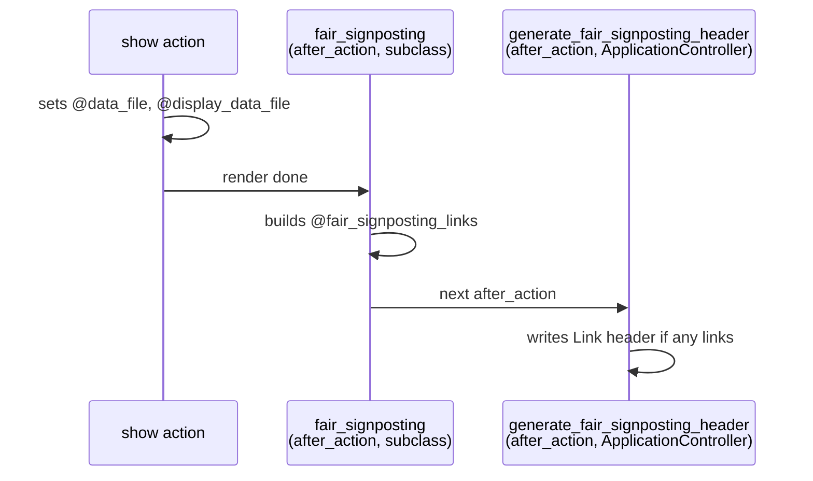

[FAIR Signposting](https://signposting.org/FAIR/) is a lightweight convention for making a web landing page machine-navigable: the HTTP response carries a `Link` header ([RFC 8288](https://www.rfc-editor.org/rfc/rfc8288)) pointing at the item's metadata, its persistent identifier and its content. A crawler or FAIR assessment tool can then follow the links without parsing HTML.

SEEK implements it in one controller concern, `FairSignposting` (`app/controllers/concerns/fair_signposting.rb`), included in `ApplicationController`.

## Example

The show page for a data file with a DOI on its second version returns:

```http
Link: <https://seek.example.org/data_files/42?version=2> ; rel="describedby" ; type="application/vnd.datacite.datacite+xml",
      <https://seek.example.org/data_files/42?version=2> ; rel="describedby" ; type="application/ld+json",
      <https://seek.example.org/data_files/42?version=2> ; rel="describedby" ; type="text/turtle",
      <https://doi.org/10.5075/abcd> ; rel="cite-as",
      <https://seek.example.org/data_files/42/download?version=2> ; rel="item" ; type="image/png"
```

(Line breaks added; the real header is a single comma-separated line.)

Each `describedby` link points at the landing page URL itself; the `type` tells the client which `Accept` header to send to get that representation by content negotiation. SEEK already serves DataCite XML, JSON-LD ([BioSchemas](../bioschema/)) and Turtle ([RDF](../rdf-endpoints/)) from the show action.

## Which pages get links

| Page | Registered in | Condition | Links |
|---|---|---|---|
| Asset show pages | `Seek::AssetsCommon` — `after_action :fair_signposting, only: [:show]` | `Seek::Config.fair_signposting_enabled` | As below |
| Index pages | `Seek::IndexPager` — `after_action :index_fair_signposting, only: [:index]` | `controller_model.schema_org_supported?` | One `describedby` → the index URL, `application/ld+json` |
| Home page | `HomesController` — `after_action :fair_signposting, only: [:index]` | none | One `describedby` → `root_url`, `application/ld+json` (the `DataCatalog` markup) |

`fair_signposting_enabled` (default off; *Admin → Features enabled*) only gates the **asset show pages**. The index and home page links are always sent — for index pages, only for types that support Schema.org.

"Asset show pages" means controllers that include `Seek::AssetsCommon`: data files, documents, models, SOPs, presentations, publications, workflows, events, collections, investigations, studies, assays, samples, sample types, strains, templates, file templates, placeholders, observation units and similar. People, projects, institutions and programmes don't include it, so their show pages have no signposting.

## Links on an asset show page

`FairSignposting#fair_signposting` builds the list from two instance variables the show action has already set (via `ResourceHelper`):

- `resource_for_controller` — the parent, e.g. `@data_file`
- `versioned_resource_for_controller` — the displayed version, e.g. `@display_data_file`; falls back to the parent for unversioned types

If the displayed resource responds to `version`, every SEEK URL carries `?version=N`, so the links describe exactly the version on screen.

| Link | Added when | Target |
|---|---|---|
| `describedby`, DataCite XML | the displayed resource responds to `datacite_metadata` (DOI-mintable types) | landing page |
| `describedby`, JSON-LD | `schema_org_supported?` | landing page |
| `describedby`, Turtle | the controller's model is in `Seek::Util.rdf_capable_types` | landing page |
| `cite-as` | the displayed resource has a `doi` | `doi_identifier` (`https://doi.org/…`) |
| `item` (only one of these) | | |
| — RO-Crate | the resource responds to `ro_crate` (workflows) | `ro_crate` URL, `application/zip`, with `profile="https://w3id.org/ro/crate"` |
| — multiple files | it has `content_blobs` and at least one (e.g. models) | download URL, `application/zip` |
| — single file | it has a `content_blob` | download URL, the blob's own `content_type` |

The `cite-as` link is per version: DOIs are minted on versions (see [Explicit Versioning](../explicit-versioning/)), so version 1 of a data file may have no `cite-as` while version 2 does.

`RO_CRATE_PROFILE` is the RO-Crate profile URI [registered with IANA](https://www.iana.org/assignments/profile-uris/profile-uris.xhtml).

## How the header is built



Two steps, both `after_action`s:

1. **Collect.** `fair_signposting` (or `index_fair_signposting`, or the home page's own `fair_signposting`) sets `@fair_signposting_links` to an array of `[url, { rel:, type:, profile: }]` pairs.
2. **Write.** `generate_fair_signposting_header`, registered by the concern's `included` block, runs only if `@fair_signposting_links` is non-empty. It formats each pair as `<url> ; key="value"`, converting a symbol `type` to its MIME string with `Mime::Type.lookup_by_extension` (so `:rdf` becomes `text/turtle`, `:jsonld` becomes `application/ld+json` — both registered in `config/initializers/mime_types.rb`), and joins them with commas.

The ordering relies on a Rails detail: **`after_action` callbacks run in reverse order of registration.** The writer is registered in `ApplicationController` (when the concern is included), and the collectors are registered later in subclasses and concerns, so the collectors run first. If you add signposting to another controller, register its collector in that controller (or a concern it includes); registering it on `ApplicationController` *before* `include FairSignposting` would make it run after the header has been written.

## Gotchas

**The header replaces any existing `Link` header.** `generate_fair_signposting_header` uses `response.set_header('Link', …)`, not an append. Rails' own asset preload `Link` header (for `application.css`/`.js`) is therefore dropped on pages that have signposting links — the tests filter those preload links out when checking pages without signposting.

**Not every page is covered by the setting.** Turning `fair_signposting_enabled` off removes links from asset pages only; index and home pages keep theirs.

**Content negotiation must actually work.** A `describedby` link promises that requesting the landing page with that MIME type returns the metadata. If you add a link type, make sure the show action responds to that format for every model the condition admits.

## Adding signposting to a new type

For an asset type that includes `Seek::AssetsCommon`, nothing is needed: the links follow from what the model responds to (`datacite_metadata`, `schema_org_supported?`, RDF capability, `doi`, `ro_crate`, `content_blob(s)`).

For a controller that doesn't, add an `after_action` that either calls `fair_signposting` (if the action sets `@<model>` and optionally `@display_<model>`) or sets `@fair_signposting_links` directly, as `HomesController` does.

## Testing

`test/integration/fair_signposting_test.rb` makes full requests and parses the `Link` header with its own `parse_link_header` helper, then checks each link with `assert_link(links, url, rel:, type:, profile:)`. It covers data files (with and without a DOI), workflows (the RO-Crate item), publications, models (zip item), SOPs, assays (RDF only), the home page, a Schema.org-supported index page, and pages that must have no links. `fair_signposting_enabled` is on in the test environment (`config/initializers/seek_testing.rb`).

## Key Files

| File | Purpose |
|---|---|
| `app/controllers/concerns/fair_signposting.rb` | Link collection for asset pages, header writer, `RO_CRATE_PROFILE` |
| `lib/seek/assets_common.rb` | Registers signposting on asset `show`, gated by the setting |
| `lib/seek/index_pager.rb` | `index_fair_signposting` for index pages |
| `app/controllers/homes_controller.rb` | Home page link |
| `app/helpers/resource_helper.rb` | `resource_for_controller`, `versioned_resource_for_controller` |
| `config/initializers/mime_types.rb` | `:datacite_xml`, `:jsonld`, `:rdf` MIME registrations |
| `test/integration/fair_signposting_test.rb` | Integration tests |
