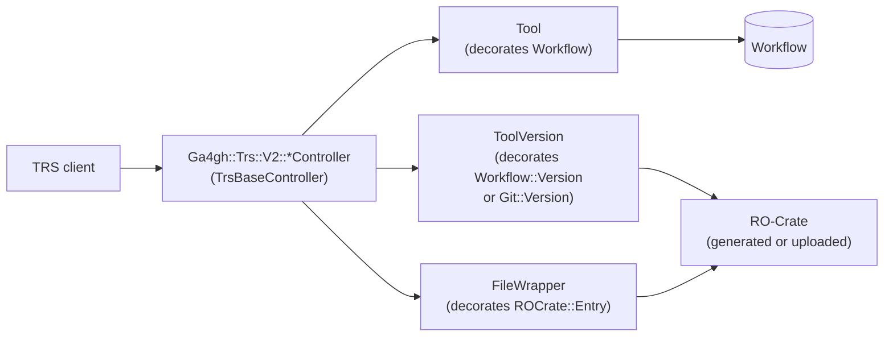

SEEK implements the [GA4GH Tool Registry Service (TRS) API](https://ga4gh.github.io/tool-registry-service-schemas/), version **2.0.1**, under `/ga4gh/trs/v2/`. It presents every viewable `Workflow` as a TRS *tool* and each of its versions as a *tool version*, so that TRS clients — workflow engines, Galaxy, Dockstore-style tooling — can discover workflows and fetch their files without knowing anything about SEEK.

The API is read-only and separate from the [JSON API](../json-api/): it has its own controllers, its own lightweight decorator models and its own serializers, and returns plain JSON rather than JSON:API documents.

## Enabling

The whole API is behind `Seek::Config.ga4gh_trs_api_enabled` (default off; *Admin → Features enabled*). When it is off, every endpoint returns a TRS error:

```json
{ "code": 404, "message": "TRS API is not enabled on this instance" }
```

The test environment turns it on in `config/initializers/seek_testing.rb`.

CORS is opened for the API in `config/initializers/cors.rb` — any origin may `GET`, `HEAD` or `OPTIONS` anything under `/ga4gh/trs/v2/*` — so browser-based TRS clients can call it directly.

## Endpoints

All routes are declared in the `ga4gh/trs/v2` namespace near the top of `config/routes.rb`.

| Route | Action | Returns |
|---|---|---|
| `GET /service-info` | `general#service_info` | GA4GH service-info document |
| `GET /toolClasses` | `general#tool_classes` | The single `Workflow` tool class |
| `GET /tools` | `tools#index` | Filtered, paginated list of tools |
| `GET /tools/:id` | `tools#show` | One tool, with its versions |
| `GET /tools/:id/versions` | `tool_versions#index` | All versions of a tool |
| `GET /tools/:id/versions/:version_id` | `tool_versions#show` | One tool version |
| `GET /tools/:id/versions/:version_id/:type/descriptor` | `tool_versions#descriptor` | The main workflow file |
| `GET /tools/:id/versions/:version_id/:type/descriptor/*relative_path` | `tool_versions#descriptor` | Any file in the crate, by path |
| `GET /tools/:id/versions/:version_id/:type/files` | `tool_versions#files` | File listing, or the whole crate with `?format=zip` |
| `GET /tools/:id/versions/:version_id/:type/tests` | `tool_versions#tests` | Test parameter files |
| `GET /tools/:id/versions/:version_id/containerfile` | `tool_versions#containerfile` | The crate's `Dockerfile` |
| `GET /extended/workflows/:organization` | `tools#index` | Tools filtered by project title |
| `GET /extended/organizations` | `general#organizations` | Titles of all projects |

`:id` is the workflow id and `:version_id` the workflow version number. `:type` is a TRS descriptor type, optionally prefixed with `PLAIN_` (see [Descriptor types](#descriptor-types)).

## Architecture



### Controllers (`app/controllers/ga4gh/trs/v2/`)

`TrsBaseController` inherits from `::ApplicationController`, so ordinary SEEK authentication applies: a client sending an API token, Basic auth or an OAuth token (see [JSON API](../json-api/#authentication)) sees the workflows that user can view, and an anonymous client sees public ones. It adds:

| Callback / handler | Behaviour |
|---|---|
| `set_format` | Treats an HTML request as JSON, so a browser or a client without an `Accept` header gets JSON |
| `check_trs_enabled` | 404 unless `ga4gh_trs_api_enabled` |
| `set_content_type` | Rewrites a `application/vnd.api+json` content type back to `application/json` — SEEK's JSON API MIME type otherwise leaks in |
| `rescue_from StandardError` | Logs, sends an exception notification, returns a TRS 500 — but only in production (or when `Thread.current[:ignore_trs_errors]` is set); in development and test the error is re-raised |
| `rescue_from RecordNotFound`, `RoutingError`, `ActionNotFound` | TRS 404 `"Not found."` |
| `rescue_from UnknownFormat` | TRS 406 |

Errors use the TRS `Error` shape, `{ "code": …, "message": … }`, or `Error <code> - <message>` as plain text when the client asked for `text/plain`.

`get_tool` loads the workflow and returns a 404 if it is missing **or not viewable** — a private workflow is indistinguishable from a non-existent one.

`ToolVersionsController` adds `check_downloadable`: the file endpoints (`descriptor`, `tests`, `files`, `containerfile`) require `can_download?`, and also answer 404 rather than 403, because TRS 2.0.1 only defines 200 and 404 responses. `check_type` returns 404 if the `:type` in the URL isn't the version's descriptor type.

### Decorators (`app/models/ga4gh/trs/v2/`)

These are plain Ruby objects, not ActiveRecord models. Each uses `delegate_missing_to`, so anything not defined on the decorator falls through to the wrapped object.

| Class | Wraps | Adds |
|---|---|---|
| `Tool` | `Workflow` | `id` as a string, `name` (title), `organization` (sorted project titles, comma-joined), `toolclass`, `versions` (as `ToolVersion`s) |
| `ToolVersion` | `Workflow::Version` or `Git::Version` | `id` (version number as a string), `name` (the git version's name, or the title), `authors`, `descriptor_type`, `list_files` |
| `ToolClass` | — | A value object; the only instance is `ToolClass::WORKFLOW` (id `1`) |
| `FileWrapper` | an `ROCrate::Entry` | `content`, `url`, `checksum` |

Because the decorators delegate, `Tool#find_version`, `Tool#can_download?` and `ToolVersion#ro_crate` are the workflow's own methods, and `find_version` works for both [explicitly versioned and git-versioned](../git-backend/) workflows.

### Serializers (`app/serializers/ga4gh/trs/v2/`)

Ordinary `ActiveModel::Serializer`s, rendered with `adapter: :attributes` and an empty root to produce bare TRS objects:

| Serializer | Attributes |
|---|---|
| `ToolSerializer` | `id`, `url` (the SEEK workflow page), `name`, `description`, `organization`, `toolclass`, `versions` |
| `ToolVersionSerializer` | `id`, `url` (the workflow page at that version), `name`, `author`, `descriptor_type` |
| `FileWrapperSerializer` | `content`, `checksum`, `url` |

`checksum` is always an empty array — checksums are not implemented.

## Listing and filtering tools

`ToolsController#paginate_and_filter` starts from `Workflow.authorized_for('view')` and applies the TRS query parameters:

| Parameter | Implementation |
|---|---|
| `id` | Exact workflow id |
| `name` | Case-insensitive substring of the title |
| `description` | Case-insensitive substring of the description |
| `toolClass` | Anything other than `Workflow` returns nothing |
| `descriptorType` | Mapped back to a `WorkflowClass` key via `ToolVersion::DESCRIPTOR_TYPE_MAPPING`; an unknown type returns nothing |
| `organization` | Exact project title (also the path segment of `/extended/workflows/:organization`) |
| `author` | A `Person` whose full name matches exactly, **or** a substring of `other_creators` |
| `checker` | Any value other than `false` returns nothing — SEEK has no checker workflows |
| `alias`, `registry`, `toolname` | Accepted but ignored |
| `offset`, `limit` | Pagination; `limit` defaults to 1000 |

The `author` filter loads every `Person` and compares names in Ruby, so it is slow on large instances.

Pagination is reported in response headers, as the spec requires: `next_page` (only when there are more results), `last_page`, `current_offset`, `current_limit` and `self_link`.

## Descriptor types

`ToolVersion::DESCRIPTOR_TYPE_MAPPING` maps SEEK's `WorkflowClass` keys to TRS descriptor types:

| `WorkflowClass` key | TRS type |
|---|---|
| `cwl` | `CWL` |
| `nextflow` | `NFL` |
| `galaxy` | `GALAXY` |
| `snakemake` | `SMK` |

A workflow of any other class (or with no class) has an empty `descriptor_type`, so its versions are listed but every file endpoint that takes a `:type` returns 404. To support a new workflow language over TRS, add its key here — it must be a type the TRS spec (or the client) recognises.

The `PLAIN_` prefix (`PLAIN_CWL`, `PLAIN_NFL`, …) asks for the raw file as `text/plain` instead of a JSON `FileWrapper`. `check_type` strips the prefix before comparing.

## Files

All file content comes from the workflow's [RO-Crate](../ro-crate/) — the uploaded crate if the workflow was submitted as one, otherwise a crate generated on the fly by `WorkflowExtraction#ro_crate` (for git workflows, the repository is checked out into a temporary directory and added to the crate).

| Endpoint | Source |
|---|---|
| `descriptor` (no path) | `crate.main_workflow` — 404 if the crate has no main workflow |
| `descriptor/*relative_path` | `crate.find_entry(relative_path)` — any file, including nested and binary ones |
| `files` | `ToolVersion#list_files`: every non-directory entry, typed `PRIMARY_DESCRIPTOR` (the main workflow), `CONTAINERFILE` (`Dockerfile`) or `OTHER` |
| `files?format=zip` | The version's crate zip (`ro_crate_zip`), sent via `RoCrateHandling#send_ro_crate` as `workflow-<id>-<version>.crate.zip` |
| `tests` | Entries matching `tests?/*.json`, as `FileWrapper`s; an empty array if there are none |
| `containerfile` | The crate's top-level `Dockerfile`, as a one-element array (JSON) or raw text |

The `files` route is declared with `format: false`, so the zip is requested with a `format=zip` **query parameter** rather than a `.zip` extension; the action checks `request.query_parameters[:format]`.

### `FileWrapper` content and binary files

`FileWrapper#content` returns the entry's text. If the entry is **remote** (a crate entity pointing at a URL), `content` is nil and `url` is the remote URI. If the bytes are **not valid in their encoding** — an image, say — `content` is nil and `url` is set to the `PLAIN_` descriptor URL for that path, so the client can fetch the raw bytes. The URL can only be built when the wrapper was given a `tool_version` and `path`, which only the `descriptor` action does.

With `PLAIN_` or `Accept: text/plain`, the descriptor action renders the file's bytes directly (or the URI, for a remote entry).

## How Galaxy uses it

The "Run on Galaxy" button on a Galaxy workflow page is built by `WorkflowExtraction#run_url`. It points at the Galaxy instance's TRS import endpoint, passing this API's tool-version URL:

```text
<galaxy>/workflows/trs_import?trs_url=<seek>/ga4gh/trs/v2/tools/<id>/versions/<version>&run_form=true
```

The Galaxy instance is the workflow's `execution_instance_url`, the URL the user typed in, or `Seek::Config.galaxy_instance_default`. Galaxy fetches the workflow anonymously, so the button only works when the TRS API is enabled **and** the workflow is publicly downloadable — `can_run?` checks `can_download?(nil)` for this reason.

`Seek::Config.galaxy_instance_trs_server` exists in `config_setting_attributes.yml` but isn't read anywhere in the application.

## Gotchas

**Some file endpoints read the latest version.** `descriptor`, `tests` and `containerfile` open `@tool.ro_crate`, which delegates to the `Workflow` itself — that is, the *current* version — rather than `@tool_version.ro_crate`. `files` (both the listing and the zip) does use the requested version. So for a workflow with several versions, asking for an older version's descriptor can return the latest version's file. The requested version is still validated (404 if it doesn't exist) and its descriptor type checked. This looks like a bug rather than a design choice.

**Errors raise outside production.** In development and test, `TrsBaseController` re-raises unexpected errors rather than rendering a TRS 500, which is what you want while developing. Tests that need to check the 500 response set `Thread.current[:ignore_trs_errors]`.

**Not-authorised is 404.** Both viewing (`get_tool`) and downloading (`check_downloadable`) failures return 404, so a missing permission looks like a missing record from the client's side.

**`organizations` lists every project.** `/extended/organizations` returns all project titles, including projects with no workflows.

## Testing

| Test | Covers |
|---|---|
| `test/functional/ga4gh/trs/v2/general_controller_test.rb` | `service-info`, `toolClasses`, organizations |
| `test/functional/ga4gh/trs/v2/tools_controller_test.rb` | Listing, visibility, each filter, pagination |
| `test/functional/ga4gh/trs/v2/tool_versions_controller_test.rb` | Versions, descriptors, files, tests, containerfile, download permission, git workflows, Snakemake, binary files, non-ASCII content |
| `test/integration/ga4gh_trs_api_test.rb` | Full request stack: disabled API, nested paths, `PLAIN_` and `Accept: text/plain`, zip download |

Factories with real crates — `:nf_core_ro_crate_workflow` (includes a `Dockerfile` and nested files), `:generated_galaxy_ro_crate_workflow`, `:remote_git_workflow` — are the quickest way to get a workflow with realistic content.

## Key Files

| File | Purpose |
|---|---|
| `config/routes.rb` | The `ga4gh/trs/v2` namespace |
| `config/initializers/cors.rb` | Open CORS for `/ga4gh/trs/v2/*` |
| `app/controllers/ga4gh/trs/v2/trs_base_controller.rb` | Enable check, format handling, error rendering, `get_tool` |
| `app/controllers/ga4gh/trs/v2/general_controller.rb` | `service-info`, `toolClasses`, organizations |
| `app/controllers/ga4gh/trs/v2/tools_controller.rb` | Tool listing, filtering, pagination |
| `app/controllers/ga4gh/trs/v2/tool_versions_controller.rb` | Versions and file access |
| `app/models/ga4gh/trs/v2/` | `Tool`, `ToolVersion`, `ToolClass`, `FileWrapper` decorators |
| `app/serializers/ga4gh/trs/v2/` | TRS JSON serializers |
| `app/models/concerns/workflow_extraction.rb` | `ro_crate`, `ro_crate_zip`, and the Galaxy `run_url` |
